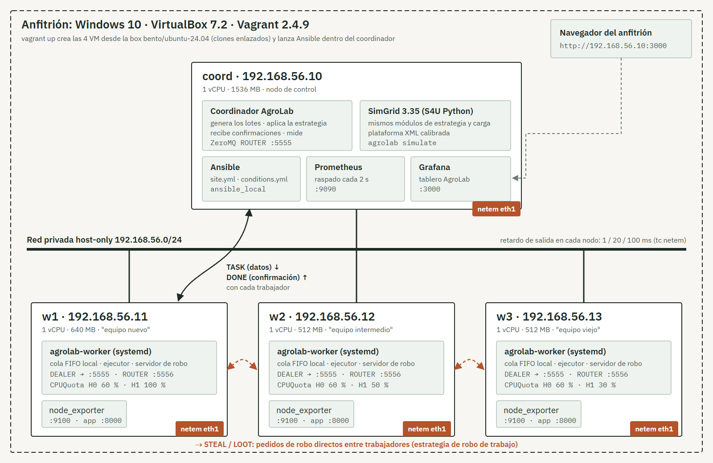

# AgroLab — del modelo a la máquina

Laboratorio distribuido reproducible para comparar estrategias de planificación y
balanceo de carga en un clúster heterogéneo, combinando **emulación** (máquinas
virtuales definidas como código con Vagrant y aprovisionadas con Ansible) y
**simulación** (SimGrid).

Trabajo Integrador Final (AE4, Propuesta B) de Sistemas Operativos Distribuidos,
Ingeniería en Sistemas de Información (FITA), ciclo 2026.
Integrantes: Quintana, Sofía · Salazar, Facundo · Vera, Romina.

> **Pregunta guía:** ¿cuánto se puede confiar en una simulación para tomar
> decisiones de diseño de un sistema distribuido?



## Qué hay en el repositorio

| Ruta | Contenido |
|---|---|
| `Vagrantfile` | 1 coordinador + N trabajadores (`N_WORKERS`, por defecto 3), red privada, recursos por nodo |
| `provisioning/` | Ansible: `site.yml` (aprovisionamiento idempotente), `conditions.yml` (latencia y heterogeneidad), roles `common`, `worker`, `coordinator`, `monitoring` |
| `src/agrolab/` | Código común al clúster real y a la simulación: estrategias, carga, coordinador, trabajador, SimGrid, calibración |
| `experiments/params.toml` | **Única fuente de parámetros** (carga, niveles de los factores, repeticiones, semillas) |
| `experiments/planilla.csv` | Planilla de corridas (orden de ejecución) |
| `experiments/calibration/` | Mediciones de calibración y `calibration.json` |
| `experiments/results/` | Datos crudos: `real/` (clúster) y `sim/` (SimGrid), en CSV versionados |
| `analysis/` | Cuaderno Jupyter con el análisis y figuras |
| `docs/` | Acta de roles, bitácoras, diagrama de arquitectura |
| `tests/` | Pruebas del módulo común y prueba de humo sin VMs |

## Requisitos

- Computadora con virtualización por hardware habilitada en la BIOS y **8 GB de RAM** (las 4 VM usan 3,2 GB).
- [VirtualBox](https://www.virtualbox.org/) 7.x y [Vagrant](https://developer.hashicorp.com/vagrant/install) 2.4.x.
- Conexión a internet la primera vez (box de Ubuntu 24.04 ≈ 0,6 GB, paquetes y Grafana).
- Git. Para el análisis en el anfitrión: Python 3.11+ (ver `analysis/requirements.txt`).

No hace falta instalar Ansible ni SimGrid en el anfitrión: Ansible se instala
dentro del coordinador (`ansible_local`) y SimGrid viene de los paquetes de
Ubuntu (`python3-simgrid`).

## Reproducir el laboratorio paso a paso

```bash
git clone https://github.com/Facundosalaa/tif-sod-vagrant-simgrid.git
cd tif-sod-vagrant-simgrid
vagrant up                 # crea w1, w2, w3 y coord; al final corre Ansible
```

Comprobaciones:

```bash
vagrant status                             # las 4 máquinas en "running"
vagrant ssh coord -c "agrolab"             # ayuda del comando del laboratorio
vagrant provision coord --provision-with ansible   # idempotencia: changed=0
```

- Grafana: <http://192.168.56.10:3000> (lectura anónima; admin/`sod2026`).
- Prometheus: <http://192.168.56.10:9090/targets>.

Ciclo completo sin intervención manual:

```bash
vagrant halt && vagrant up        # apagar y volver a encender
vagrant destroy -f && vagrant up  # borrar todo y reconstruir desde cero
```

Otra cantidad de trabajadores: `N_WORKERS=2 vagrant up` (en PowerShell:
`$env:N_WORKERS=2; vagrant up`).

## Ejecutar el experimento

Todo se corre desde el coordinador (`vagrant ssh coord`):

```bash
agrolab calibrate            # paso 6: velocidades, red y costo del coordinador
agrolab simulate trivial     # paso 4: una tarea, un nodo, contra la cuenta a mano
agrolab plan                 # genera experiments/planilla.csv desde params.toml
agrolab run                  # paso 5: ejecuta la planilla (se puede cortar y retomar)
agrolab simulate validate    # mismas configuraciones en SimGrid
agrolab simulate scale       # paso 7: 16, 64, 256 y 512 nodos
```

Los resultados quedan en `experiments/results/` (la carpeta del proyecto está
compartida con el anfitrión). Para un bloque solo: `agrolab run --only L20-H1`.

Condiciones a mano (las aplica `agrolab run` en cada bloque):

```bash
cd /vagrant/provisioning
ansible-playbook conditions.yml -e '{"delay_ms": 20, "quotas": {"w1": 100, "w2": 50, "w3": 30}}'
ansible all -b -a "lab-netem show"
```

## Análisis

En el anfitrión:

```bash
python -m pip install -r analysis/requirements.txt
python analysis/export_prometheus.py     # consumo de las VM durante la campaña
jupyter lab analysis/analisis.ipynb
```

## Pruebas sin VMs

```bash
python tests/test_strategies.py   # módulo común
python tests/smoke_local.py       # coordinador y 3 trabajadores en localhost (requiere pyzmq)
```

## Problemas conocidos

- **Anfitrión Windows con Hyper-V activo** (WSL2, Docker Desktop): VirtualBox
  corre sobre la API de Hyper-V, más lento, y las VM con 2 vCPU se cuelgan al
  azar durante el arranque. Por eso todas las VM usan 1 vCPU.
- **Una VM "inaccesible" registrada en VirtualBox** (aparece como
  `<inaccessible>` en `VBoxManage list vms`) hace fallar `vagrant up` con
  `E_ACCESSDENIED`, porque Vagrant revisa los puertos de todas las VM. Hay que
  desregistrarla (`VBoxManage unregistervm <uuid>`).
- **Finales de línea:** el repositorio fuerza LF (`.gitattributes`). Si los
  scripts fallan con `\r`, clonar de nuevo con `git config --global core.autocrlf false`.
